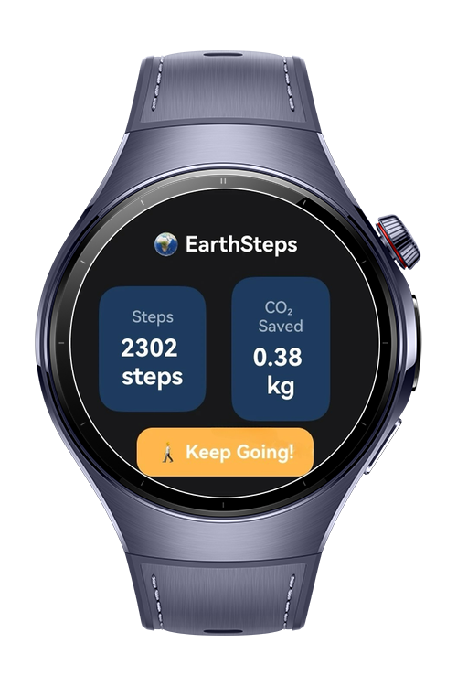
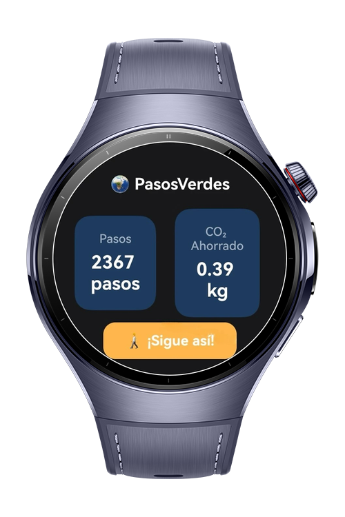
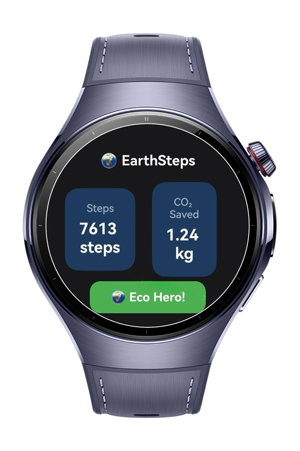
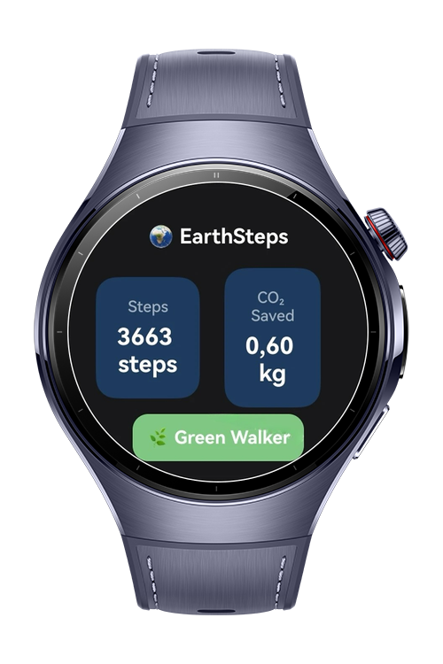

> **Note:** To access all shared projects, get information about environment setup, and view other guides, please visit [Explore-In-HMOS-Wearable Index](https://github.com/Explore-In-HMOS-Wearable/hmos-index).

# Carbon Footprint Step Tracker

Carbon Footprint Step Tracker is a lightweight and sensor-powered HarmonyOS app designed to promote eco-friendly behavior by encouraging users to walk. By leveraging step count data, the app calculates the carbon dioxide (CO₂) savings achieved by walking instead of using a vehicle. It offers a responsive interface, live tracking features, and multilingual support using mock localization.

# Preview

<div>
  
  
  
  
</div>

# Use Cases

- Measures daily steps and encourages physical activity.
- Converts distance walked into estimated CO₂ savings.
- Switch between English, Turkish, and French (mocked).
- Live updates from the step counter sensor.

# Technology

## Stack
- **Languages**: ArkTS, ArkUI
- **Frameworks**: HarmonyOS SDK 5.0.2(14)
- **Tools**: DevEco Studio Version 5.1.0.828
- **Libraries**:
    - `@kit.ArkUI`
    - `@kit.SensorServiceKit`
    - `@kit.PerformanceAnalysisKit`
    - `@kit.BackgroundTasksKit`
    - `@kit.AbilityKit`

## Required Permissions
- `ohos.permission.ACTIVITY_MOTION`
- `ohos.permission.ACCELEROMETER`

# Directory Structure

```
entry/
└── src/
└── main/
└── ets/
├── common   # Constants and configuration
│   └── constants.ets
├── components    # Reusable visual components
│   ├── EcoStatCard.ets
│   └── EcoBadge.ets
├── model      # Data model
│   └── EcoDataModel.ets
├── pages     # App screens
│   └── MainPage.ets
├── services         # Business logic and APIs
│   └── StepSensorService.ets
├── utils       # Permission class
│   └── PermissionUtil.ets
└── viewmodel   # View models (MVVM pattern)
    └──MainViewModel.ts
```

# Constraints and Restrictions
## Supported Device

* Huawei Watch 5

# License

**Carbon Footprint Step Tracker** is distributed under the terms of the MIT License
See the [LICENSE](./LICENSE) for more information.